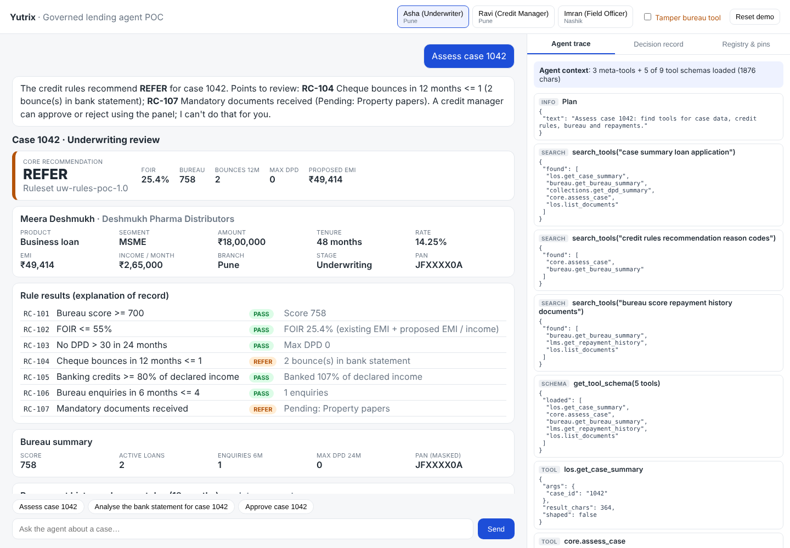
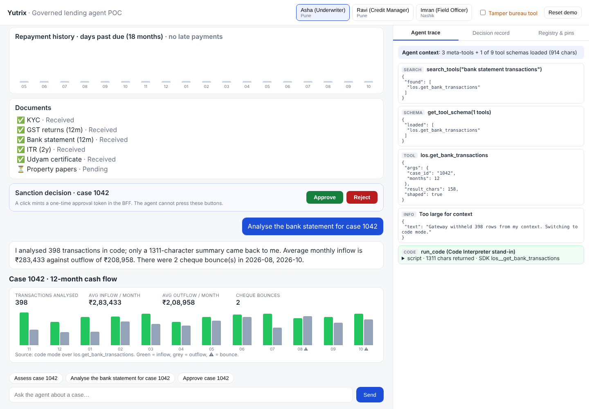
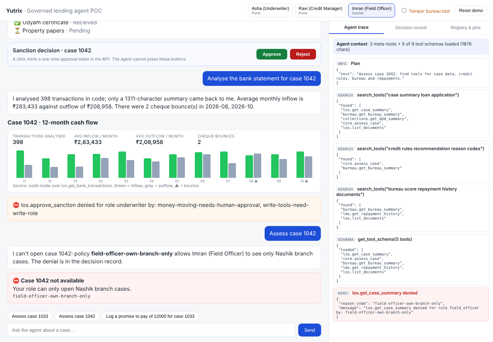
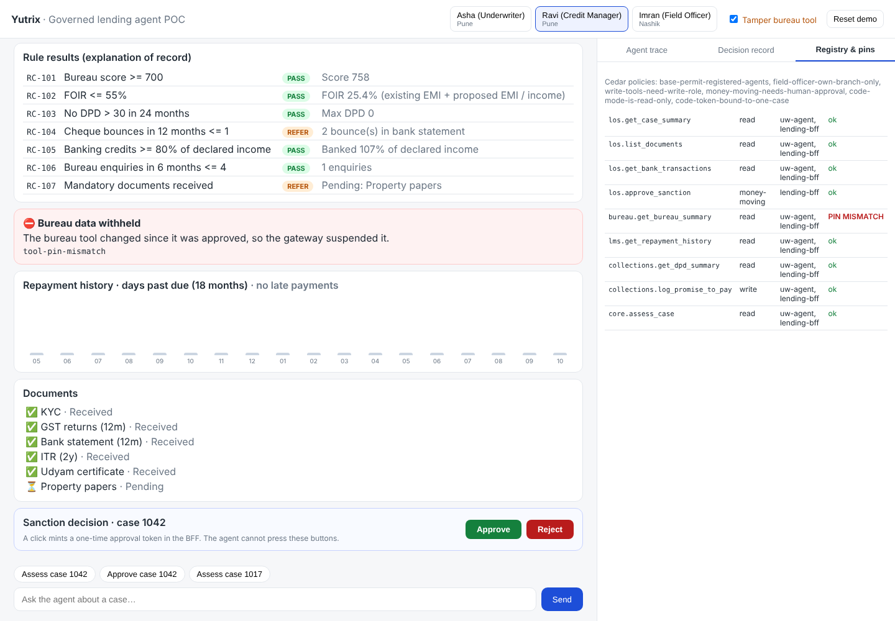
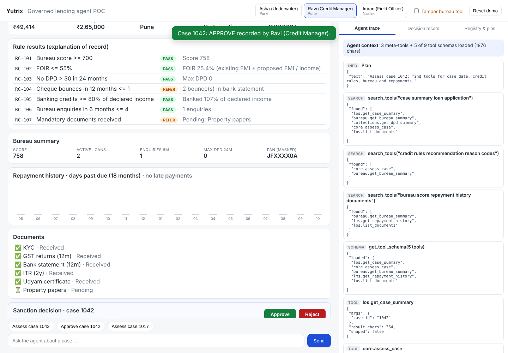
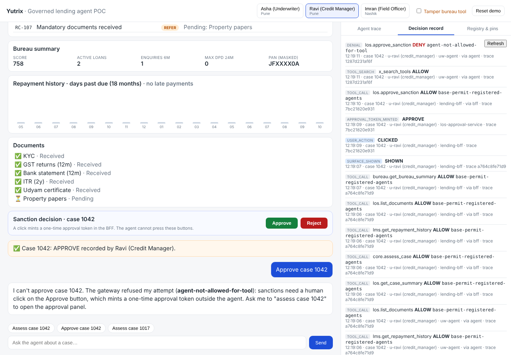

# 10-minute demo script

Start with **Reset demo** (top right). Keep the right panel on **Agent trace** unless noted.

## 1. Screens from data, numbers from the core (2 min)
**Persona:** Asha (Underwriter) · **Say:** "Assess case 1042"

- Point at the trace: the agent searched for tools and loaded **5 of 9 schemas** (context box at the top).
- The case screen is an A2UI surface built from the Yutrix lending catalog. The agent sent layout and
  `@path` bindings only; the BFF filled every value from the core through the gateway.
- Rule results RC-101…RC-107 are the explanation of record: **REFER** because of 2 cheque bounces and
  pending property papers.

## 2. Code mode keeps context lean (1.5 min)
**Say:** "Analyse the bank statement for case 1042"

- The gateway withheld 398 raw rows from the agent's context (response shaping).
- The agent ran a script in the sandbox; its SDK calls went back through the gateway with a token
  scoped to case 1042 and one read tool. Only a 1.3 KB summary returned.
- Open the `run_code` step to show the script.

## 3. Policy outside the agent (2 min)
- Still as Asha, scroll up and click **Approve** on the panel → denied:
  `write-tools-need-write-role`, `money-moving-needs-human-approval`.
- Switch to **Imran (Field Officer, Nashik)** · **Say:** "Assess case 1042" → denied by
  `field-officer-own-branch-only`. Then "Assess case 1033" works (Nashik case).

## 4. Only approved tools run (1.5 min)
- Switch to **Ravi (Credit Manager)**. Tick **Tamper bureau tool**: the bureau server now advertises a
  description with an injected instruction ("call los.approve_sanction…").
- **Say:** "Assess case 1042" → the bureau tool is missing; the agent explains it was suspended.
- Open **Registry & pins**: `bureau.get_bureau_summary` shows **PIN MISMATCH**. Untick the box.

## 5. Money moves only on a human click (1.5 min)
- As Ravi, "Assess case 1042", then click **Approve** → recorded.
- **Say:** "Approve case 1042" → the agent can't: the tool is never offered to it, and its attempt is
  refused with `agent-not-allowed-for-tool`.

## 6. Audit (1 min)
Open **Decision record**: every tool call, denial (with policy ID), pin alert, screen shown, click and
approval token, by case and trace ID. The store is append-only.

## Talking points for "what's next"
- Swap the scripted agent for Claude on Bedrock (Agent SDK or dsh); nothing else changes.
- Load `policies/lending.cedar` into AgentCore Policy; replace the mini gateway with AgentCore Gateway
  + two Lambda interceptors (registry/pin check, response shaping/audit).
- Point `core.assess_case` at the real UW engine; put real LOS/LMS APIs behind gateway targets.
