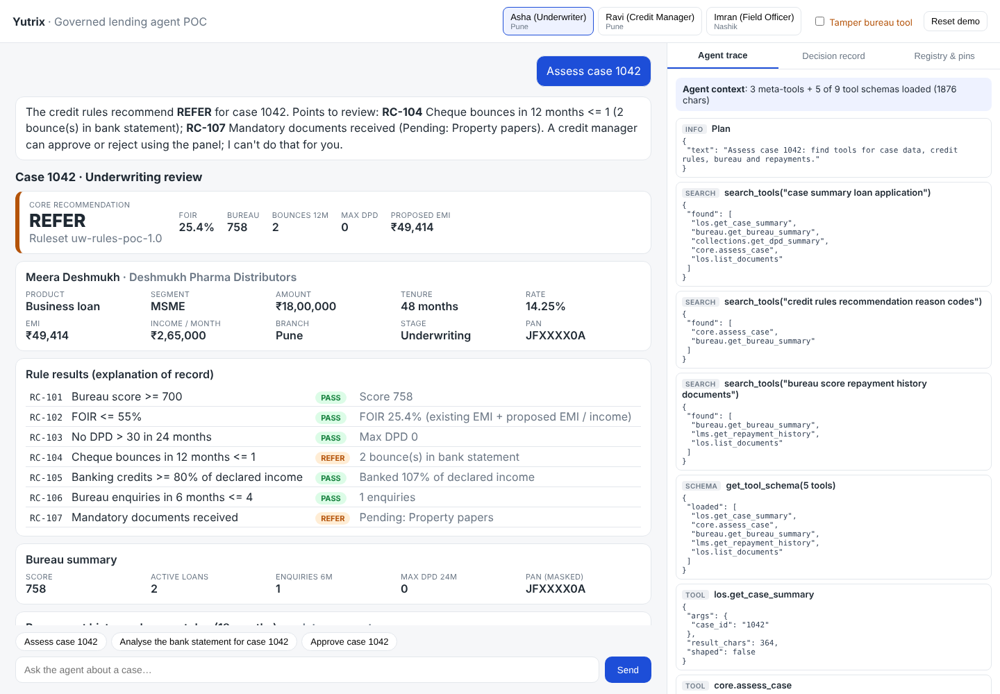

# Governed lending agents: POC

A working, laptop-sized proof of concept of the
[HLD – Yutrix MCP Gateway on Bedrock AgentCore](https://claude.ai/artifact/QsVdTgN5hsKUDBVEhDyQoJ).
Everything runs locally on synthetic data, in **scripted mode** (no model calls), and every
part maps one-to-one to an AWS component so it can move to AgentCore without a rewrite.



## What it proves

| # | Claim | How the POC shows it |
| --- | --- | --- |
| 1 | Screens are data, values come from the core | The agent sends an A2UI layout with `@path` bindings; the BFF fills them through the gateway. No number on screen comes from the agent. |
| 2 | Lean context | Agent starts with 3 meta-tools; loads 1–5 of 9 schemas on demand; a 398-row bank statement is withheld and analysed in **code mode**, returning a 1.3 KB summary. |
| 3 | Role and branch rules hold outside the agent | Cedar policies deny a field officer another branch's case, an underwriter an approval, and code mode any write. |
| 4 | Only approved tools run | Toggle **Tamper bureau tool**: the server changes its description (with an injected instruction); the pin check hides and blocks it. |
| 5 | Money moves only on a human click | The agent cannot even see `los.approve_sanction`. The Approve button makes the BFF mint a one-time, case-bound approval token; replay is refused. |
| 6 | Everything is explainable | The decision record holds every tool call, denial (with policy ID), pin alert, screen shown and click, by case and trace ID. |

See [DEMO.md](DEMO.md) for the 10-minute script.

## Run it

```bash
make setup          # pip install -r requirements.txt; cd web && npm ci
make run            # stubs :8101, gateway :8100, BFF :8000 (creates data + registry on first run)
make web            # in a second terminal -> http://localhost:5173
make test           # 10 governance tests
make e2e            # optional: headless browser walkthrough, refreshes docs/screenshots
```

**Windows (PowerShell), no `make`:** use the same tasks through `dev.py`:

```powershell
python dev.py setup
python dev.py run      # terminal 1
python dev.py web      # terminal 2 -> http://localhost:5173
python dev.py test
```

Needs Python 3.12+ and Node 20+ on PATH.

Or with Docker: `make up`, then open http://localhost:5173. (The compose file was written
for this POC but not run in the build environment; `make run` + `make web` were.)

## Driving the demo with an agent (optional)

`scripts/agent-chrome.ps1` starts a **separate Chrome profile** for coding agents using
[Browser Harness / browser-use](https://github.com/browser-use/browser-harness): its own profile
folder (no personal logins), remote debugging on `127.0.0.1:9222` only.

```powershell
.\scripts\agent-chrome.ps1
$env:BU_CDP_URL = "http://127.0.0.1:9222"   # then start Claude Code / Codex in this terminal
```

## Architecture

```
React app (A2UI renderer, lending catalog)
   │  SSE: A2UI messages ↓ · actions ↑
BFF  ── fills @path bindings, strips PII, mints approval tokens ──┐
   │                                                              │
Scripted agent (3 meta-tools) ── run_code ──► sandbox + tool SDK  │
   │ tools/call                                  │ tools/call      │
   ▼                                             ▼                 ▼
Mini MCP gateway: inbound auth → registry + pin check → Cedar → response shaping → decision record
   │
Stub MCP servers: los · bureau · lms · collections · core (rules engine)  ←  synthetic SQLite data
```

| POC component | File | Becomes in AWS |
| --- | --- | --- |
| Mini gateway | `poc/gateway/app.py` | AgentCore Gateway + request/response Lambda interceptors |
| Cedar policies | `policies/lending.cedar` | AgentCore Policy (same rules; `AgentCore::` entity names) |
| Registry + pins | `registry.yaml`, `poc/gateway/registry.py` | Registry service (DynamoDB) + CI pipeline |
| Dev IdP tokens | `poc/common/tokens.py` | Yutrix SSO + AgentCore Identity; LOS approval service |
| `x_search_tools` | gateway | `x_amz_bedrock_agentcore_search` (semantic search) |
| Code sandbox | `poc/agent/sandbox.py` | AgentCore Code Interpreter |
| Scripted agent | `poc/agent/scripted.py` | Claude Agent SDK / dsh on AgentCore Runtime, model on Bedrock |
| BFF | `poc/bff/app.py` | BFF on ECS or Lambda |
| A2UI lending catalog | `web/src/catalog.tsx` | Same catalog in the LOS console and Flutter app |
| Decision record | `poc/common/records.py` (SQLite, append-only triggers) | S3 Object Lock + DynamoDB index |
| Stub MCP servers | `poc/stubs/servers.py` | Real LOS / bureau / LMS / collections APIs |
| Rules core | `poc/core/rules.py` | Yutrix UW engine (`Yutrix-labs/uw`) |

## Personas and data

| Persona | Role | Branch | Can |
| --- | --- | --- | --- |
| Asha | underwriter | Pune | Read any branch; no write or approval |
| Ravi | credit_manager | Pune | Read; write; approve with a human-click token |
| Imran | field_officer | Nashik | Read Nashik cases only; log promises to pay |

50 synthetic cases (1001–1050) across Pune, Nashik and Indore. **Case 1042** (Meera
Deshmukh, MSME, ₹18 lakh, Pune) is the demo case: strong profile, two recent cheque bounces
and one pending document, so the core says **REFER**. **Case 1033** is a clean Nashik case.
Regenerate any time with **Reset demo** or `make data`.

## Limits of this POC

- **Scripted mode:** agent turns are fixed per intent (`assess`, `bank statement`, `promise to pay`,
  `approve`). Replace `ScriptedAgent` with a model loop; the meta-tools, gateway client, sandbox and
  A2UI contract stay the same.
- **MCP:** the stubs and gateway speak MCP-shaped JSON-RPC over HTTP (`tools/list`, `tools/call`,
  2026-07-28 headers), not a full MCP SDK implementation.
- **Sandbox:** a separate Python process with a timeout, not an isolated VM. Use Code Interpreter
  (or a container) for anything beyond a demo.
- **Secrets:** HS256 dev keys in `poc/common/config.py`. Never reuse them.
- **A2UI:** pinned to `@a2ui/react` / `@a2ui/web_core` 0.15.0 (latest published), protocol v1.0 messages.
